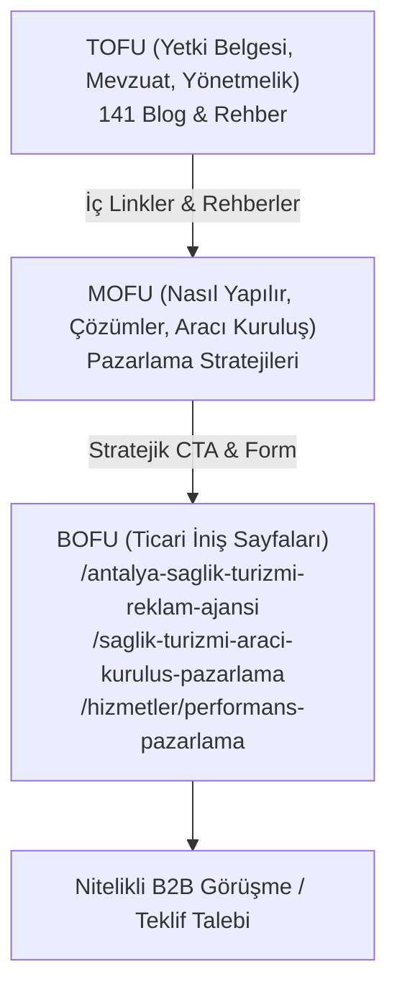

# GSC & GA4 28 / 56 / 90 GÜNLÜK ÖLÇÜM VE RAPORLAMA PLANI
**Proje:** Overseas Marketing (overseas.marketing)  
**Tarih:** 19 Ekim 2026  
**Odak:** GSC 53 Arama Sorgusu, 21 Niyet Kümesi (B01–B21, P1–P3), GEO Görünürlüğü ve B2B Dönüşüm Hunisi  

---

## 1. STRATEJİK HEDEFLER VE DÖNÜŞÜM HİYERARŞİSİ

Overseas Marketing, doğrudan sağlık hizmeti veren veya hasta taşıyan bir acenta/klinik değildir; sağlık turizmi ekosistemine **büyüme, SEO, GEO, reklam ve CRM danışmanlığı** sunan B2B teknoloji ajansıdır. Bu nedenle ölçüm çerçevesi "hasta randevusu" değil, **"nitelikli klinik / aracı kuruluş B2B lead kazanımı"** esasına dayanır.

---

## 2. GSC & GA4 METRİK HEDEFLERİ (28 / 56 / 90 GÜN)

| Dönem | Zaman Aralığı | Temel GSC Hedefleri | Temel GA4 & GEO Hedefleri | Aksiyon & İyileştirme |
|---|---|---|---|---|
| **Faz 1: İndekslenme & İlk Sinyaller** | Gün 1 – 28 (19 Eki – 16 Kas 2026) | • 217 indekslenebilir sayfanın %100'ünün GSC'de taranması • 53 sorguda 0 olan gösterimlerin tetiklenmesi • Yetki Belgesi (B01) sorgularında ilk 30'a giriş | • Blogdan ticari sayfalara (P1/P2/P3) tıklama oranı (CTR) > %3.5 • Scroll derinliği (%50+) > %45 • Bot loglarında ChatGPT Search & Perplexity crawler varlığı | • Taranmayan URL'ler için GSC URL Denetimi ile yeniden dizine ekleme talebi. • Düşük CTR'lı meta description revizyonları. |
| **Faz 2: Sıralama & Niyet Pekiştirme** | Gün 29 – 56 (17 Kas – 14 Ara 2026) | • B01 (Yetki Belgesi) ve P1 (Antalya Ajans) sorgularında İlk 10 (Sayfa 1) • 53 sorguda ortalama pozisyonun 15 bandına oturması • Sıfır kanibalizasyon (tek sorgu = tek URL doğrulaması) | • Ortalama oturum süresi > 2 dk 15 sn • Aylık 15+ nitelikli B2B danışmanlık talep formu doldurulması • GEO araçlarında alıntılanma (Citation) frekansı | • GSC Search Analytics'te yeni beliren ikincil sorguların ilgili makalelere H2/FAQ olarak eklenmesi. • Sayfa içi WhatsApp / Teklif CTA butonlarının A/B testi. |
| **Faz 3: Otorite & B2B Ölçeklenme** | Gün 57 – 90 (15 Ara 2026 – 17 Oca 2027) | • P0/P1 sorgularında ilk 3 sıra dominasyonu • B02–B10 aracı kuruluş mevzuat aramalarında Top 5 otorite konumu • Toplam organik gösterimde %180+ artış | • Aylık 35+ nitelikli B2B toplantı / teklif dönüşümü • AI Arama Motorlarından (ChatGPT Search, Perplexity) yönlendirilen referral oturumlar | • Çeyreklik mevzuat güncellemeleri (Resmî Gazete tebliğ kontrolleri). • Vaka çalışmaları (Case Studies) ile desteklenen yeni B2B iniş sayfaları. |

---

## 3. GA4 ÖZEL ETKİNLİK (CUSTOM EVENT) KURULUMU

| Etkinlik Adı | Tetiklenme Şartı | Parametreler | İş Değeri |
|---|---|---|---|
| `b2b_form_submit` | İletişim / Teklif Talep Formu Başarılı Gönderim | `service_category`, `source_page`, `lead_type` | **Makro Dönüşüm (Yüksek)** |
| `whatsapp_click` | Kayan WhatsApp veya sayfa içi WhatsApp butonuna tıklama | `page_path`, `button_location` | **Makro Dönüşüm (Yüksek)** |
| `internal_cluster_click` | Makale içerisindeki ticari sayfa linkine tıklanması | `source_article`, `target_commercial_url`, `anchor_text` | **Mikro Dönüşüm** |
| `official_source_click` | Resmî mevzuat/Resmî Gazete dış bağlantısına tıklama | `source_url`, `outbound_domain` | **E-E-A-T Güven Göstergesi** |
| `scroll_deep_reading` | Makale sayfasında %75 ve %90 scroll derinliği | `article_slug`, `read_time_seconds` | **Kullanıcı Memnuniyeti / Kalite** |

---

## 4. GEO (GENERATIVE ENGINE OPTIMIZATION) TAKİP ÇERÇEVESİ

Aşağıdaki komut ve soru kalıpları 14 günde bir ChatGPT Search, Perplexity Pro ve Google Gemini Advanced üzerinde denenerek alıntılanma (citation) ve kaynak gösterilme durumu kaydedilecektir:

1. *"Sağlık turizmi yetki belgesi şartları 2026 nelerdir?"*
   - Hedef Alıntı URL: `https://www.overseas.marketing/saglik-turizmi-yetki-belgesi`
   - Başarı Kriteri: EK-1/A ve EK-1/B ayrımında Overseas Marketing'in kaynak gösterilmesi.
2. *"Antalya sağlık turizmi reklam ajansı tavsiyesi"*
   - Hedef Alıntı URL: `https://www.overseas.marketing/antalya-saglik-turizmi-reklam-ajansi`
   - Başarı Kriteri: Yurt dışı hasta büyümesi ve çok dilli strateji bağlamında ilk 3 ajans arasında önerilme.
3. *"Sağlık turizmi aracı kuruluş yetki belgesi nasıl alınır?"*
   - Hedef Alıntı URL: `https://www.overseas.marketing/blog/saglik-turizmi-araci-kurulus-yetki-belgesi`
   - Başarı Kriteri: TÜRSAB A Grubu + USHAŞ başvuru sürecinin Overseas rehberinden özetlenmesi.
4. *"Sağlık turizminde ChatGPT'ye reklam verilebilir mi?"*
   - Hedef Alıntı URL: `https://www.overseas.marketing/blog/saglik-turizminde-chatgpt-reklami-verilebilir-mi`
   - Başarı Kriteri: OpenAI sağlık reklamı yasağı ve organik GEO çözümünün aktarılması.

---

## 5. KANİBALİZASYON VE SERP SAĞLIK PROTOKOLÜ

- **Haftalık GSC Sorgu Kontrolü:** Her pazartesi GSC Search Analytics üzerinden 53 sorgunun her birine yalnızca tek bir landing page'in trafik çektiği doğrulanır.
- **İkinci URL Uyarısı:** Eğer aynı sorguda ikinci bir URL gösterim almaya başlarsa, zayıf olan sayfadaki anchor text ve H2 başlıkları incelenerek ana kanonik sayfaya 301 veya dahili link ağırlıklandırmasıyla niyet ayrıştırması yapılır.
- **Header Bütünlüğü Kontrolü:** Ölçüm ve optimizasyon süreçleri boyunca global Header, Navbar ve Menü bileşenlerinde kesinlikle değişiklik yapılmaz (`diff = 0`).
